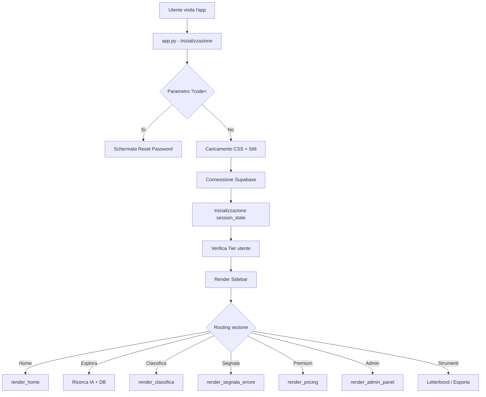
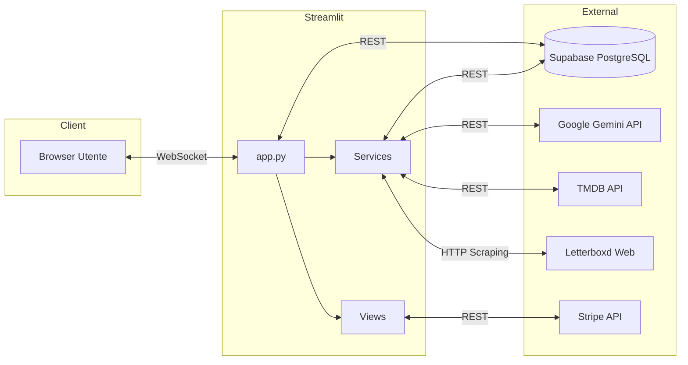

# 🏗️ Audit Architetturale — FilmBloopers Hub

> **Data:** 2026-10-24  
> **Autore:** Software Architect / Senior Python Developer  
> **Versione:** 1.0  

---

## 1. Panoramica del Progetto

**FilmBloopers Hub** è una piattaforma web italiana per la catalogazione, esplorazione e discussione di errori cinematografici (bloopers, incongruenze, anacronismi). L'applicazione combina intelligenza artificiale generativa (Gemini), dati da API cinematografiche (TMDB), scraping di profili Letterboxd e un sistema di monetizzazione via Stripe.

**Dominio di produzione:** `https://filmbloopers.online/`  
**App Streamlit:** `https://cinemabloopers.streamlit.app/`

---

## 2. Stack Tecnologico

| Livello | Tecnologia | Versione |
|---------|-----------|----------|
| **Frontend/UI** | Streamlit | Non pinned |
| **Backend** | Python (monolitico) | Non pinned |
| **Database** | Supabase (PostgreSQL) | Managed |
| **IA Generativa** | Google Gemini (google-genai SDK) | Multi-modello |
| **API Cinematografica** | TMDB API v3 | REST |
| **Scraping** | BeautifulSoup4 + Requests | — |
| **Pagamenti** | Stripe Checkout | API v3 |
| **CSS** | Custom glassmorphism + inline HTML | — |
| **Deploy** | Streamlit Community Cloud / Render | — |

### Dipendenze (`requirements.txt`)
```
streamlit, supabase, google-genai, pandas, requests,
beautifulsoup4, google-generativeai, stripe, tornado
```

> ⚠️ **Criticità:** Nessuna versione è pinned. Build non riproducibili.  
> ⚠️ **Duplicato:** Sia `google-genai` che `google-generativeai` sono inclusi.

---

## 3. Architettura Applicativa

### 3.1 Pattern: Monolite MVC-like su Streamlit

```
app.py (Controller/Router principale)
├── views/              ← Rendering delle sezioni (V)
│   ├── home_view.py
│   ├── esplora_view.py
│   ├── community_view.py
│   ├── pricing_view.py
│   └── strumenti_view.py
├── components/         ← Componenti UI riusabili
│   ├── sidebar.py
│   ├── modals.py
│   └── admin_components.py
├── services/           ← Logica di business / API esterne
│   ├── ai_service.py
│   ├── tmdb_service.py
│   └── letterboxd_service.py
├── utils/              ← Utility trasversali
│   ├── callbacks.py
│   └── styles.py
├── translations.py     ← i18n (non integrato)
├── style.css           ← CSS glassmorphism
├── reset.html          ← Password reset (GitHub Pages)
└── sitemap.xml         ← SEO
```

### 3.2 Flusso di Esecuzione



---

## 4. Problemi Architetturali Critici

### 🔴 P1 — Doppio `st.set_page_config()`
**File:** `app.py`, righe 5-9 e 37-42  
Il metodo viene invocato **due volte** con parametri diversi. Streamlit lancia un errore runtime alla seconda chiamata.

### 🔴 P2 — Logica di business nel layer di presentazione
La classifica (`community_view.py`) esegue **UPDATE diretti sul database** per assegnare premi premium. Questa logica dovrebbe risiedere in un servizio dedicato o in una funzione Supabase Edge.

### 🔴 P3 — Assenza di caching
Ogni ricaricamento della pagina esegue `supabase.table("films").select("*").execute()` (riga 233 di app.py), scaricando l'**intera tabella films**. Nessun uso di `@st.cache_data` o `@st.cache_resource`.

### 🟡 P4 — Traduzioni non integrate
`translations.py` contiene un dizionario completo per 6 lingue ma **non è mai importato né usato** nell'applicazione. Tutta l'UI è hardcoded in italiano.

### 🟡 P5 — Funzione `normalizza()` duplicata
La stessa funzione di normalizzazione Unicode è definita in 3 file diversi:
- `views/esplora_view.py`
- `views/strumenti_view.py`
- `services/ai_service.py` (come `normalizza_ai`)

### 🟡 P6 — Routing basato su stringhe
Il routing delle sezioni in `app.py` usa confronti letterali di stringhe (`if sezione == "Home"`, `elif "Segnala un Errore" in sezione`). Il mismatch con `cb_logout()` che imposta `"🏠 Home"` (con emoji) causerà routing fallito.

### 🟡 P7 — Bare `except: pass` diffusi
Decine di blocchi `except: pass` nascondono errori silenziosamente. Nessun logging strutturato lato server.

### 🟡 P8 — Client Supabase passato come parametro ovunque
Il client Supabase viene creato una volta in `app.py` e poi passato come argomento a ogni funzione/view. Non esiste un pattern di dependency injection o service locator.

---

## 5. Flusso Dati



---

## 6. Scalabilità

| Aspetto | Stato | Note |
|---------|-------|------|
| Concorrenza | ⚠️ | Streamlit è single-threaded per sessione |
| Database | ⚠️ | Query senza paginazione su tabelle in crescita |
| IA | ✅ | Fallback multi-modello con retry |
| Caching | 🔴 | Assente |
| Rate Limiting | ⚠️ | Solo lato client (`session_state`) |
| Deploy | ⚠️ | Streamlit Community Cloud = cold starts |

---

## 7. Raccomandazioni Prioritarie

1. **Rimuovere il secondo `st.set_page_config()`** — Bug bloccante
2. **Introdurre `@st.cache_data`** su tutte le query read-only
3. **Centralizzare `normalizza()`** in `utils/text.py`
4. **Estrarre la logica dei premi** dalla view classifica in un service
5. **Pinned versions** in `requirements.txt`
6. **Rimuovere `google-generativeai`** (duplicato di `google-genai`)
7. **Sostituire bare `except`** con logging strutturato
8. **Usare enum/costanti** per il routing delle sezioni
