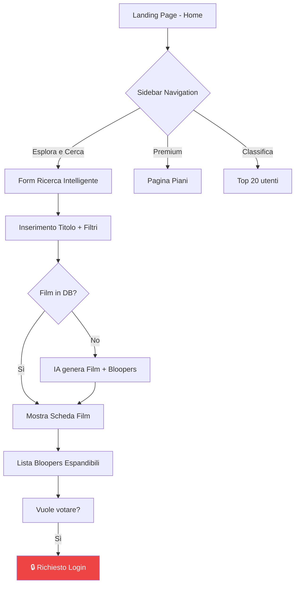
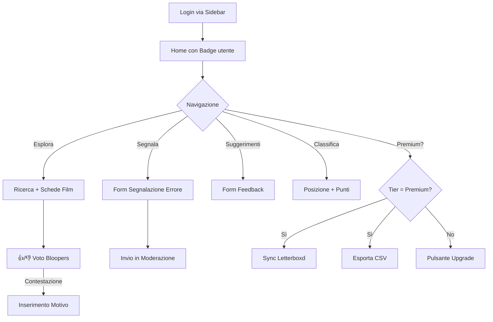
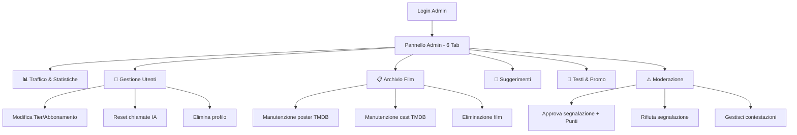

# 🎨 Audit UX/UI — FilmBloopers Hub

> **Data:** 2026-10-24  
> **Autore:** UX/UI Designer  
> **Versione:** 1.0  

---

## 1. Panoramica Design System

### 1.1 Palette Colori

| Ruolo | Colore | Hex | Uso |
|-------|--------|-----|-----|
| Background primario | Blu scuro profondo | `#070a10` / `#0b1120` | Sfondo app |
| Background card | Slate scuro | `#111827` | Card, pannelli |
| Bordo principale | Grigio scuro | `#1f2937` | Bordi card |
| Testo primario | Bianco freddo | `#f9fafc` | Titoli, testo principale |
| Testo secondario | Grigio chiaro | `#9ca3af` / `#d1d5db` | Sottotitoli, caption |
| Accento primario | Blu Streamlit | `#2563eb` / `#3b82f6` | Pulsanti, link attivi |
| Accento secondario | Arancione | `#fb923c` | Highlight, affiliazioni |
| Accento promo | Giallo oro | `#facc15` / `#fef08a` | Badge premium, promo |
| Successo | Verde smeraldo | `#10b981` / `#22c55e` | Conferme, checkmark |
| Errore | Rosso | `#ef4444` / `#f87171` | Errori, negazioni |
| Blu info | Celeste | `#60a5fa` / `#93c5fd` | Info, link secondari |

### 1.2 Effetti Visivi

- **Glassmorphism**: `backdrop-filter: blur(16px)` con sfondo semitrasparente
- **Sfondo cinematografico**: Immagine Unsplash di sala cinema con overlay scuro
- **Gradient radiali**: Effetto luce blu dalla parte superiore dello schermo
- **Micro-animazioni**: `translateY(-2px)` su hover pulsanti, `translateX(3px)` su hover sidebar

---

## 2. Flussi Utente

### 2.1 Flusso Visitatore (Ospite)

### 2.2 Flusso Utente Registrato

### 2.3 Flusso Amministratore

---

## 3. Problemi UX Identificati

### 🔴 Critici

#### UX-C1: Doppia pagina di reset password
Esistono **due** flussi per il reset password:
1. Streamlit: se l'URL ha `?code=` → form inline in `app.py`
2. GitHub Pages: `reset.html` — pagina HTML statica

L'utente viene indirizzato a `reset.html` dall'email (riga 233 sidebar.py), ma `app.py` gestisce anch'esso il `?code=`. Confusione garantita.

#### UX-C2: Nessun feedback di caricamento per la ricerca IA
Quando si cerca un film non presente nel DB, l'IA può impiegare 5-15 secondi. L'utente vede uno spinner Streamlit generico senza:
- Indicazione del progresso
- Stima del tempo
- Possibilità di annullare

#### UX-C3: Layout sidebar sovraffollata
La sidebar contiene: logo, navigazione, form di ricerca (3 campi + 2 pulsanti), expander community, expander strumenti pro, expander admin, expander account, box quota. Troppi elementi per uno spazio ristretto.

### 🟡 Migliorabili

| ID | Problema | Dettaglio |
|----|----------|-----------|
| UX-M1 | Risultati film non paginati | Lista completa di tutti i film come radio buttons |
| UX-M2 | Nessun onboarding | L'utente nuovo non ha un tour guidato |
| UX-M3 | Form ricerca scompare | Quando non si è nella sezione "Esplora", il form sparisce |
| UX-M4 | Pulsanti footer troppo piccoli | `font-size: 9px` per Privacy, TOS, Cookie |
| UX-M5 | Mobile responsiveness limitata | Streamlit gestisce il responsive, ma i layout a 5-6 colonne collassano male |
| UX-M6 | Emoji come icone | Anziché icone SVG coerenti, l'app usa emoji Unicode (rendering diverso per OS) |
| UX-M7 | Nessuna breadcrumb | L'utente non sa dove si trova nell'app |
| UX-M8 | Modale admin gigantesca | 579 righe di componente monolitico con 6 tab dense |
| UX-M9 | Tabella pricing a 5 colonne | Illeggibile su mobile, le colonne si sovrappongono |

---

## 4. Accessibility (A11Y)

| Criterio WCAG | Stato | Note |
|---------------|-------|------|
| **1.1 Alt Text** | ⚠️ | I poster usano `st.image()` senza alt text esplicito |
| **1.3 Semantica** | 🔴 | Tutto è `st.markdown()` con HTML inline, nessuna struttura semantica |
| **1.4 Contrasto** | ✅ | Testo chiaro su sfondo scuro rispetta i rapporti minimi |
| **2.1 Navigazione tastiera** | ⚠️ | Gestita da Streamlit, ma i pulsanti inline non hanno focus visibile |
| **3.1 Lingua** | 🔴 | Nessun `lang="it"` nell'HTML generato da Streamlit |
| **4.1 Compatibilità** | ⚠️ | HTML inline non validato, possibili tag non chiusi |

---

## 5. Design Positivi

| Aspetto | Valutazione |
|---------|------------|
| Palette colori coerente dark mode | ✅ Eccellente |
| Glassmorphism ben implementato | ✅ Premium feel |
| Sfondo cinematografico con overlay | ✅ Tematico |
| Gamification (punti, gradi, classifica) | ✅ Engagement |
| Sistema badge utente sidebar | ✅ Informativo |
| Gradiente radiale di sfondo | ✅ Profondità visiva |

---

## 6. Raccomandazioni

1. **Unificare** il flusso di reset password in un'unica pagina
2. **Aggiungere stepper/progress bar** durante le operazioni IA
3. **Semplificare la sidebar** con navigazione iconica collassabile
4. **Paginare** i risultati dei film (max 20 per pagina)
5. **Aggiungere un tour onboarding** per i nuovi utenti
6. **Rendere responsive** la tabella pricing (layout card su mobile)
7. **Sostituire emoji** con icone SVG da una libreria coerente (Lucide/Heroicons)
8. **Spezzare `admin_components.py`** in sotto-componenti per tab
