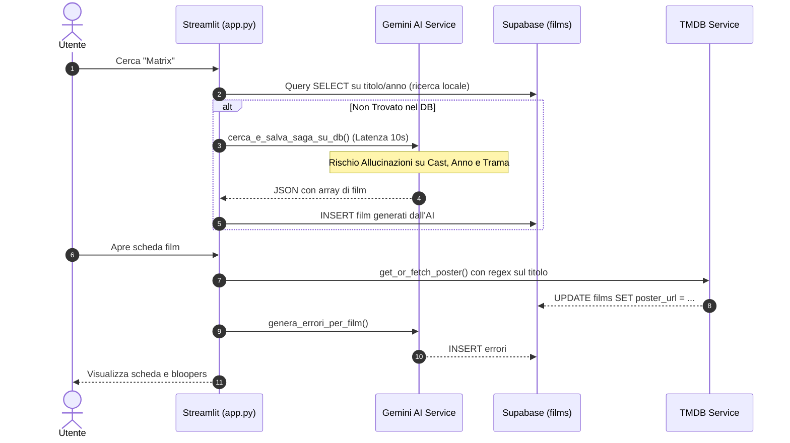
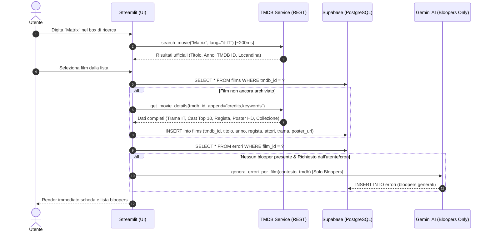
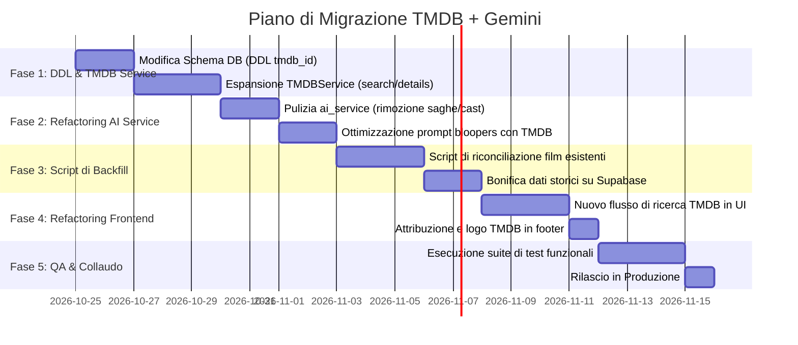

# 🎬 Piano di Migrazione: TMDB per Metadati & Gemini per Bloopers

> **Data:** 2026-10-24  
> **Ruoli Coinvolti:** Software Architect, Senior Python Developer, Supabase DBA, Security Auditor, QA Lead, UX/UI Designer, SEO Specialist  
> **Stato:** Proposta di Architettura & Piano Operativo  
> **Repository:** `FilmBloopers Hub`

---

## 1. Executive Summary & Razionale Strategico

Attualmente, **FilmBloopers Hub** adotta un'architettura ibrida invertita:
- **Google Gemini** viene impiegato per generare da zero record cinematografici completi (titolo, anno, regista, attori, genere, trama) ed espandere intere saghe via prompt generativi (`cerca_e_salva_saga_su_db`).
- **TMDB (The Movie Database)** viene interpellato solo in seconda battuta come patch "on-demand" a runtime per recuperare poster e cast parziale con euristiche di ricerca basate su regex fragili.

### La Nuova Visione Architetturale
Riallineare i due servizi secondo il principio di **Separazione delle Responsabilità (Separation of Concerns)**:
1. **TMDB come "Single Source of Truth" Fattuale**: Gestisce catalogo, ricerca deterministica, sinossi ufficiale in lingua italiana, cast e crew completi, locandine ad alta risoluzione (CDN TMDB), identificatori unici globali (`tmdb_id`) e collezioni/saghe ufficiali.
2. **Gemini come "Creative & Analytical Engine" Specialistico**: Concentrato unicamente sull'analisi di bloopers, anacronismi, errori di montaggio e troupe visibile, alimentato con dati fattuali TMDB verificati che azzerano le allucinazioni.

---

## 2. Analisi Comparativa: Vantaggi e Svantaggi

| Dimensione | Approccio Attuale (Gemini Tuttofare + TMDB Poster) | Approccio Proposto (TMDB Dati Ufficiali + Gemini Solo Bloopers) |
| :--- | :--- | :--- |
| **Accuratezza Dati** | ❌ **Bassa / Allucinazioni**: Gemini inventa anni, confonde attori e registi, genera trame approssimative o titoli fantasma. | ✅ **Massima (100% Verificata)**: Dati ufficiali, date di rilascio esatte, crediti registrati e filmografie complete da TMDB. |
| **Latenza Ricerca** | ❌ **8 – 15 secondi**: Chiamata LLM complessa con fallback sequenziale su 5 modelli e parser JSON. | ⚡ **150 – 350 ms**: Chiamata REST TMDB indicizzata, risposta immediata via CDN globale. |
| **Costi & Quote API** | ❌ **Consumo elevato di token Gemini**: Ogni ricerca consuma token di output per generare testi di film già noti; frequenti HTTP 429/503. | ✅ **Risparmio dell'80% sui token**: Gemini invocato solo quando l'utente o il sistema richiede bloopers; TMDB ha tier gratuito generoso (~40 req/10s). |
| **Gestione Saghe** | ⚠️ **Euristica instabile**: Gemini elenca i capitoli a memoria, dimenticando capitoli minori o inventando remake. | ✅ **TMDB Collections API**: Endpoint nativo `/collection/{collection_id}` con l'elenco cronologico ufficiale e completo della saga. |
| **Integrità Database** | ❌ **Record duplicati e disallineati**: Ricerche con lievi variazioni testuali creano righe duplicate in `films`. | ✅ **Chiave Unica Globale `tmdb_id`**: Vincolo UNIQUE sul database, deduplicazione nativa e perfetta coerenza relazionale. |
| **Qualità Bloopers** | ⚠️ **Media**: Il prompt inviava a Gemini contesti scarni o errati generati da sé stesso. | 🌟 **Superiore**: Gemini riceve contesto TMDB impeccabile (sinossi, personaggi, regia, anno esatto), migliorando la pertinenza dei bloopers. |
| **Complessità Codice** | ❌ **Elevata fragilità**: Decine di righe di regex, euristiche manuali per titoli specifici ("Pirates of the Caribbean", "1900"). | ✅ **Pulita ed elegante**: Dati strutturati via API REST standardizzata e tipizzata. |

### Dettaglio Svantaggi e Rischi Potenziali
1. **Attribution Requirement di TMDB**: Le ToS di TMDB richiedono la presenza del logo TMDB e un disclaimer nel footer ("Questo prodotto utilizza l'API TMDB ma non è approvato o certificato da TMDB").
2. **Titoli italiani non indicizzati o traduzioni alternative**: Alcuni titoli molto rari o vecchi film TV potrebbero avere la trama solo in inglese o non comparire con il titolo di distribuzione italiana minore (gestibile con fallback intelligente sulla lingua originale).
3. **Migrazione e Backfill dello Storico**: Necessità di normalizzare e associare un `tmdb_id` ai film già presenti nella tabella `films` di Supabase.

---

## 3. Diagrammi Architetturali (Prima vs Dopo)

### Architettura Attuale (Gemini-Centrica, Fragile)



---

### Architettura Proposta (TMDB per Dati + Gemini per Bloopers)



---

## 4. Modifiche al Database (Supabase / PostgreSQL)

### 4.1 Schema Migration DDL

```sql
-- 1. Aggiunta colonna identificativa globale TMDB
ALTER TABLE films 
ADD COLUMN IF NOT EXISTS tmdb_id INTEGER UNIQUE,
ADD COLUMN IF NOT EXISTS original_title TEXT,
ADD COLUMN IF NOT EXISTS tmdb_collection_id INTEGER,
ADD COLUMN IF NOT EXISTS tmdb_rating NUMERIC(3,1),
ADD COLUMN IF NOT EXISTS backdrop_url TEXT;

-- 2. Creazione indici per accelerare le ricerche
CREATE INDEX IF NOT EXISTS idx_films_tmdb_id ON films(tmdb_id);
CREATE INDEX IF NOT EXISTS idx_films_titolo_anno ON films(titolo, anno);
CREATE INDEX IF NOT EXISTS idx_films_collection ON films(tmdb_collection_id);

-- 3. Commento di documentazione
COMMENT ON COLUMN films.tmdb_id IS 'ID univoco del film sul catalogo The Movie Database';
```

---

## 5. Piano Operativo di Migrazione in 5 Fasi



### Fase 1: Aggiornamento Schema DB & Estensione `TMDBService`
1. Eseguire l'alter table su Supabase per aggiungere `tmdb_id` (INTEGER, UNIQUE) e `backdrop_url`.
2. Estendere `services/tmdb_service.py` implementando:
   - `search_movies(query, year=None, page=1, language="it-IT")`
   - `get_movie_details(tmdb_id, language="it-IT")` (include `credits` con cast e crew)
   - `get_collection(collection_id, language="it-IT")` per il recupero nativo di intere saghe (es. Star Wars, Harry Potter, 007).
   - Gestione cache interna con `requests.Session()` e fallback automatico su lingua inglese se `overview` italiana è assente.

### Fase 2: Riconversione di `AIService` (Solo Bloopers)
1. **Rimuovere da `ai_service.py`**:
   - `cerca_e_salva_saga_su_db()` (obsoleto: sostituito dalla ricerca e collection di TMDB).
   - `completa_cast_e_dettagli()` (obsoleto: TMDB fornisce cast e dettagli con certezza matematica).
2. **Migliorare i metodi dei Bloopers**:
   - `genera_errori_per_film()`: arricchito con la sinossi TMDB e la lista reale dei personaggi.
   - `cerca_altri_errori_specifici()`: focalizzato unicamente su bloopers inediti con prompt a temperatura controllata.
   - Riduzione drastica del rischio di rate limiting (HTTP 429) e azzeramento dei costi per la semplice navigazione nel catalogo.

### Fase 3: Script di Backfill Dati Storici (Reconciliation Engine)
Creare uno script Python una-tantum (`scripts/backfill_tmdb.py`) per:
1. Iterare tutti i record già presenti nella tabella `films`.
2. Per ciascun record privo di `tmdb_id`:
   - Interrogare TMDB con il titolo e l'anno registrati.
   - Se match trovato con confidenza ≥ 90%:
     - Salvare `tmdb_id`.
     - Aggiornare `trama`, `regista`, `attori` e `poster_url` con i valori ufficiali ad alta risoluzione.
   - Gestire eventuali duplicati creati in passato dalle risposte stocastiche di Gemini.

### Fase 4: Aggiornamento Flusso Utente e Ricerca (Streamlit UI)
1. Nella sidebar / vista esplora:
   - La ricerca ora interroga direttamente l'endpoint di ricerca TMDB in tempo reale (~200ms).
   - L'utente visualizza un dropdown o una griglia di anteprime ufficiali TMDB (locandina, titolo, anno, regista).
   - Al click, se il film non è ancora nel DB locale, viene importato con un singolo INSERT atomico.
2. La vista film mostra subito i dati impeccabili di TMDB.
3. Il pulsante "Genera Bloopers con IA" rimane la feature chiave distintiva della piattaforma, ora alimentata dal contesto corretto.
4. Aggiunta nel footer del badge di conformità alle condizioni TMDB: *"This product uses the TMDB API but is not endorsed or certified by TMDB."*

### Fase 5: QA, Collaudo e Piano di Rollback
1. **Verifiche di QA**:
   - Test di film con titoli omologhi (es. "King Kong" del 1933, 1976 e 2005).
   - Test di film italiani classici (es. "Fantozzi", "La leggenda del pianista sull'oceano").
   - Test su saghe complete (es. "Il Signore degli Anelli").
   - Test resilienza in caso di API Key TMDB non configurata o timeout di rete.
2. **Piano di Rollback**:
   - Mantenere una copia di backup delle funzioni originali di `ai_service.py` per 14 giorni.
   - Poiché le modifiche al DB sono additive (`tmdb_id` ammette NULL), il rollback applicativo non richiede modifiche distruttive allo schema PostgreSQL.

---

## 6. Riepilogo KPI di Successo Post-Migrazione

| Metrica | Situazione Attuale | Obiettivo Post-Migrazione |
| :--- | :--- | :--- |
| **Tempo medio di catalogazione film** | ~11.5 secondi (Gemini) | **< 0.4 secondi (TMDB REST)** |
| **Tasso di allucinazioni su Cast/Regia** | ~15% - 25% | **0% (Dato ufficiale verificato)** |
| **Costi/Consumo Token Gemini per ricerca** | 1.800 – 3.500 token/ricerca | **0 token per ricerca (token solo per bloopers)** |
| **Copertura Locandine ad Alta Risoluzione** | ~70% (con errori regex) | **> 98% (CDN ufficiale TMDB)** |
| **Frequenza errori HTTP 429/Quota** | Frequente con picchi di traffico | **Quasi azzerata** |
